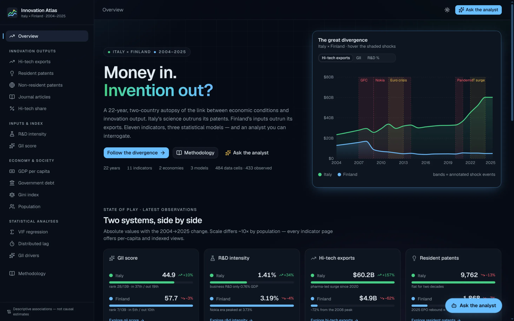
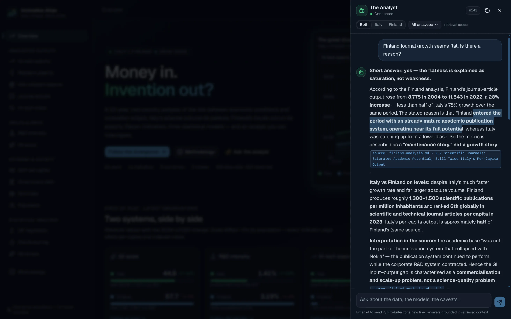

<h1 align="center">
  Innovation Atlas
</h1>

<p align="center">
  A comparative innovation-economy dashboard for Italy × Finland (2004–2025) with a FastAPI + ChromaDB RAG backend and a React + TypeScript dashboard — eleven indicators with annotated shock events, three statistical analyses (VIF regression, distributed lag, GII drivers), and an AI analyst that answers from the analysis notes with source citations.
</p>

<p align="center">
  
  
  
  
  
  
  
  
  
  
  
  
  
  
  
  
  
</p>

<p align="center">
  
</p>

<p align="center">
  
</p>

# Innovation Atlas — Italy × Finland, 2004–2025

A comparative dashboard on economic factors and innovation output: 11 indicators,
3 statistical analyses (VIF regression, distributed lag, GII drivers), annotated
shock events on every chart, and an AI analyst that answers questions from the
analysis notes with source citations. This is done as an assignment in technology management course (held at fall-2026 at Amirkabir University Of Technology).

- **Dashboard** — React 19 + Vite + Tailwind 4 + shadcn (Base UI) + Recharts.
  All chart data is bundled, so every page works even with the backend off.
- **Backend** — FastAPI + ChromaDB RAG (`backend/`), serving the AI chat on port **9123**.

```
innovation-analysis/
├── run.sh          ← one-command setup & run (Linux / macOS / WSL / Git Bash)
├── run.bat         ← Windows double-click launcher (delegates to run.sh)
├── backend/        ← FastAPI app, .env.example, knowledge ingest script
├── dashboard/      ← React dashboard
├── data/           ← knowledge/*.md (RAG sources) + processed/*.json
└── notebooks/      ← analysis notebook
```

---

## Option A — One command (recommended)

Nothing needs to be pre-installed. The script downloads **Node.js, pnpm and uv**
into a project-local `.tools/` folder (no admin rights, no system changes),
installs all dependencies, starts both servers, and opens your browser.
First run downloads ~1 GB and can take 5–10 minutes.

**Linux / macOS / WSL / Git Bash:**

```bash
chmod +x run.sh    # once
./run.sh
```

**Windows:** double-click **`run.bat`** (or run it from a terminal).
It finds Git Bash; if missing, it installs Git for Windows via `winget`,
then runs the same `run.sh`.

What the script does:

1. Installs any missing toolchain (Node ≥ 22, pnpm, uv) into `./.tools/`.
2. Creates `backend/.env` if missing and **prompts for your API key**
   (press Enter to skip — charts work without it, the AI chat won't).
3. `uv sync` (uv manages Python itself) and `pnpm install`.
4. Builds the AI knowledge index if needed (see [Knowledge base](#knowledge-base--ingest)).
5. Starts the backend (`:9123`) and dashboard (`:5173`), waits until healthy,
   opens the browser. **Ctrl+C stops both.** Logs go to `logs/`.

| Flag        | Effect                                                                  |
| ----------- | ----------------------------------------------------------------------- |
| `--ingest`  | Force-rebuild the AI knowledge index (needs API key)                    |
| `--no-open` | Don't open a browser                                                    |
| `--clean`   | Wipe `.tools/`, `backend/.venv`, `dashboard/node_modules` and reinstall |
| `--yes`     | Non-interactive; never prompt for the API key                           |
| `--help`    | Usage                                                                   |

---

## Configure the AI provider (`backend/.env`)

The script creates this file and prompts you, but you can also do it manually —
**required for Option B**, and whenever you want to change provider settings.

Copy the example file, then **replace the placeholder key with your own**
(and set the base URL if you use an OpenAI-compatible provider):

```bash
# Linux / macOS / WSL / Git Bash
cp backend/.env.example backend/.env
```

```powershell
# Windows PowerShell
Copy-Item backend\.env.example backend\.env
```

Edit `backend/.env`:

```env
# ---- OpenAI / compatible provider ----
OPENAI_API_KEY=sk-...
OPENAI_BASE_URL=
OPENAI_CHAT_MODEL=gpt-6-luna
OPENAI_EMBED_MODEL=text-embedding-3-small

# ---- storage ----
CHROMA_DIR=./chroma_db
KNOWLEDGE_DIR=../data/knowledge
DATA_DIR=../data/processed

# ---- http ----
DASHBOARD_ORIGIN=http://localhost:5173

# ---- chunking ----
CHUNK_SIZE=600
CHUNK_OVERLAP=80
TOP_K=5

# ---- session ----
SESSION_TTL_SECONDS=3600
```

Notes:

- `OPENAI_API_KEY` — **your own key**. Without it the dashboard still works;
  only the AI chat is disabled.
- `OPENAI_BASE_URL` — leave **empty** for the official OpenAI API, or point it at
  any OpenAI-compatible endpoint (Groq, Together, a local gateway, …).
- `OPENAI_CHAT_MODEL` — must be a model your provider actually serves.
- `OPENAI_EMBED_MODEL` — used for the knowledge index. If you change it,
  re-run the ingest (embeddings must match).
- **Restart the backend after editing `.env`.**
- `backend/.env` is gitignored — never commit real keys.

---

## Option B — Two terminals (manual)

Prerequisites: [uv](https://docs.astral.sh/uv/), Node.js ≥ 22 (or 20.19+), and
[pnpm](https://pnpm.io/installation). Create `backend/.env` first (see above).

**Terminal 1 — backend** (FastAPI on `127.0.0.1:9123`):

```bash
cd backend
uv sync          # creates .venv; downloads Python 3.12+ if needed
uv run poe dev
```

**Terminal 2 — dashboard** (Vite on `localhost:5173`):

```bash
cd dashboard
pnpm install
pnpm dev
```

Open **http://localhost:5173**. The dev server proxies `/api/*` →
`http://127.0.0.1:9123/*`, so the chat is same-origin and CORS-free.
If your backend runs elsewhere, set `VITE_API_BASE_URL` in `dashboard/.env`
(see `dashboard/.env.example`).

Stop each server with Ctrl+C in its terminal.

### Once running

| What               | URL                          |
| ------------------ | ---------------------------- |
| Dashboard          | http://localhost:5173        |
| API health         | http://127.0.0.1:9123/health |
| API docs (Swagger) | http://127.0.0.1:9123/docs   |

---

## Knowledge base & ingest

The AI analyst answers **only** from `data/knowledge/*.md` (VIF analysis,
Italy / Finland country notes), embedded into `backend/chroma_db/`.

Rebuild the index after editing those files, changing `OPENAI_EMBED_MODEL`,
or on a fresh checkout without `chroma_db`:

```bash
cd backend
uv run python scripts/ingest_knowledge.py            # update: re-embeds only changed/new files
uv run python scripts/ingest_knowledge.py --rebuild  # full rebuild
```

(or `./run.sh --ingest`, or `POST /ingest?rebuild=true`). Requires a valid API
key. Note: `data/` is gitignored, so a fresh clone may not include it — the
dashboard is unaffected (its data is bundled in `dashboard/src/data/`), and the
committed `chroma_db/` keeps the chat working; only re-ingesting needs the files.

Chat sessions persist across refreshes (a `session_id` in `localStorage` mirrors
backend memory). The **Reset** button clears both and starts a fresh session.

---

## Troubleshooting

| Symptom                                    | Fix                                                                                                                                                                                                           |
| ------------------------------------------ | ------------------------------------------------------------------------------------------------------------------------------------------------------------------------------------------------------------- |
| Chat shows “Backend offline”               | Backend isn't running on 9123. Start it (Option B, terminal 1) or check `logs/backend.log`.                                                                                                                   |
| Chat errors: 401 / model not found         | Wrong `OPENAI_API_KEY`, `OPENAI_BASE_URL` or `OPENAI_CHAT_MODEL` in `backend/.env`. Fix and restart the backend.                                                                                              |
| “Not enough context” answers               | Knowledge not ingested, or the chat filter is set to DLM / GII / Data prep while only the VIF + country notes exist in `data/knowledge/`. Use **All analyses**, or add the missing `.md` files and re-ingest. |
| Windows: `uv sync` fails building `uvloop` | Use the provided `backend/pyproject.toml` (uvloop is POSIX-only there).                                                                                                                                       |
| Windows: granian won't start               | The script auto-retries with uvicorn. Manually: `uv run --with uvicorn uvicorn app.main:app --host 127.0.0.1 --port 9123`.                                                                                    |
| Port 5173 busy                             | Vite picks the next free port; the script detects and opens the actual URL.                                                                                                                                   |
| Toolchain feels broken                     | `./run.sh --clean` reinstall everything local (data and `.env` are kept).                                                                                                                                     |

All statistics shown are **descriptive associations on small samples — not
causal estimates**. HC3 robust errors are authoritative where reported.
